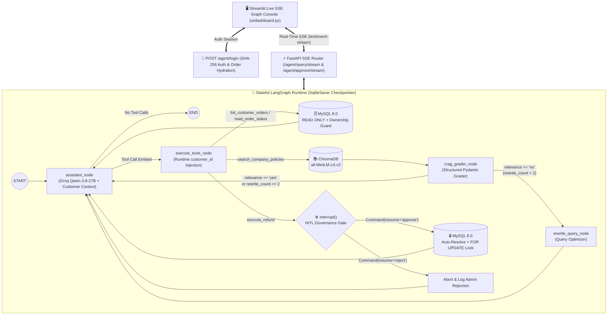

# ⚡ Autonomous Enterprise Ops Engine v3.0


A production-grade, multi-tenant **Agentic AI Operations Engine** built with **FastAPI**, **LangGraph**, **MySQL 8.0**, **ChromaDB**, and **Streamlit**.

Designed for enterprise customer operations, **v3.0** combines **Role-Based Authentication (`Customer` vs. `Admin`)**, **Cross-Tenant IDOR Security Guardrails**, **Self-Healing Corrective RAG (CRAG)**, and **Smart Refund Auto-Resolution** while intercepting **100% of state-mutating financial SQL transactions** behind a deterministic **Human-in-the-Loop (HITL)** approval gate streamed live via **Server-Sent Events (SSE)**.

---

## 🏗️ System Architecture & LangGraph State Machine



---

## ✨ What's New in v3.0

* **Role-Based Authentication & Session Isolation (`/agent/login`):** Users authenticate against MySQL (`customers` table with SHA-256 password hashing and `customer` / `admin` roles). The authenticated `customer_id` is bound to `AgentState` and injected at runtime into tool calls.
* **Cross-Tenant IDOR Security Guardrails:** Customer-scoped SQL queries verify account ownership before returning order details or executing refunds—preventing Customer #1 (`Alice Smith`) from inspecting or refunding Customer #2's (`Bob Jones`) orders.
* **Smart Order & Amount Auto-Resolution (`execute_refund` & `list_customer_orders`):** Customers no longer need to memorize order IDs or dollar figures. If a user says *"I want a refund because my headphones arrived broken"*, `execute_refund` automatically locks (`SELECT ... FOR UPDATE`) and resolves their eligible `'delivered'` order and full `total_amount` from MySQL.
* **Live SSE Graph Console (`ui/dashboard.py`):** Upgraded glassmorphic SaaS operator console featuring a sticky real-time LangGraph state-machine visualizer, live SSE node telemetry, and role-gated HITL approval controls.
* **Self-Healing Corrective RAG (CRAG):** Evaluates retrieved chunks from `Company_policy.pdf` via a structured Pydantic grader (`GradeDocuments`) and rewrites failed search queries up to 2 times.
* **Defense-in-Depth SQL Safety:** Enforces `SET SESSION TRANSACTION READ ONLY` on lookup tools, row-level `FOR UPDATE` locking on writes, schema-level `UNIQUE(order_id)` idempotency on `refunds`, and `Decimal` bounds checking (`amount <= total_amount`).

---

## 🔐 Pre-Seeded Demo Accounts (`seed.py`)

When you run `python seed.py` (or launch via Docker Compose), the following demo accounts and orders are automatically provisioned:

| Role | Name | Email | Password | Pre-Seeded Orders |
|---|---|---|---|---|
| **Customer #1** | Alice Smith | `alice@example.com` | `alice123` | **Order #999:** Wireless Noise-Cancelling Headphones (`$50.00`, `delivered`)<br/>**Order #404:** Enterprise Workstation Monitor (`$1200.00`, `processing`) |
| **Customer #2** | Bob Jones | `bob@example.com` | `bob123` | **Order #555:** Mechanical Keyswitch Developer Keyboard (`$150.00`, `delivered`) |
| **Administrator** | Enterprise Admin | `admin@example.com` | `admin123` | Full HITL Governance Console access to Approve / Reject paused refund transactions |

---

## 📂 Repository Structure

```text
Autonomous_Enterprise_Ops_Engine_3.0/
├── app/
│   ├── agent/
│   │   └── agent.py          # LangGraph StateGraph, CRAG nodes, HITL interrupt(), SqliteSaver
│   ├── db/
│   │   └── database.py       # MySQL connection pool with Read-Only / Read-Write session guards
│   ├── routers/
│   │   └── agent.py          # FastAPI /agent/login, SSE streaming, & REST endpoints
│   ├── schemas/
│   │   └── schemas.py        # Pydantic contracts (LoginRequest, QueryRequest, ApprovalRequest)
│   ├── tools/
│   │   ├── __init__.py       # Tool registry (4 tools exported to LangGraph)
│   │   ├── rag_tools.py      # ChromaDB retriever (HuggingFace all-MiniLM-L6-v2)
│   │   └── sql_tools.py      # RBAC-guarded SQL tools with smart order/amount auto-resolution
│   └── main.py               # FastAPI application entry point
├── ui/
│   └── dashboard.py          # SaaS Live SSE Graph Console & HITL Approval Gate
├── tests/
│   ├── test_guardrails.py    # 11 deterministic unit tests (Auth, IDOR, Pydantic, SQL guards)
│   └── test_agent_evals.py   # 3 end-to-end LangGraph trajectory, CRAG, and HITL safety evals
├── Company_policy.pdf        # Enterprise operations & refund policy corpus (9 sections)
├── seed.py                   # Idempotent MySQL schema/user seeder & PDF vector ingestion script
├── Dockerfile                # Python 3.11 container image with pre-cached HuggingFace embeddings
├── docker-compose.yml        # Orchestrates MySQL 8.0, FastAPI backend, and Streamlit UI
├── pytest.ini                # Pytest markers and PYTHONPATH configuration
├── requirements.txt          # Python dependencies
└── .env.example              # Environment variable template
```

---

## 🚀 Quickstart Guide

### Option A: One-Command Docker Compose (Recommended)

1. **Clone the repository and configure environment variables:**
   ```bash
   git clone [https://github.com/](https://github.com/)<your-username>/Autonomous-Enterprise-Ops-Engine.git
   cd Autonomous-Enterprise-Ops-Engine
   cp .env.example .env
   ```
   *Open `.env` and add your `GROQ_API_KEY` (and optional `LANGCHAIN_API_KEY` for LangSmith).*

2. **Launch the full stack (MySQL 8.0 + Auto-Seed + FastAPI + Streamlit):**
   ```bash
   docker compose up --build
   ```
   * **Streamlit Live SSE Console:** `http://localhost:8501`
   * **FastAPI Swagger Docs:** `http://localhost:8000/docs`

---

### Option B: Local Python Virtual Environment

1. **Create and activate a virtual environment:**
   ```powershell
   python -m venv .venv
   .\.venv\Scripts\Activate.ps1
   pip install -r requirements.txt
   ```

2. **Seed MySQL tables, demo users, and ChromaDB embeddings:**
   ```powershell
   python seed.py
   ```

3. **Run FastAPI and Streamlit in two terminals:**
   ```powershell
   # Terminal 1: FastAPI Backend
   uvicorn app.main:app --reload --port 8000

   # Terminal 2: Streamlit Live SSE Console
   streamlit run ui/dashboard.py --server.port 8501
   ```

---

## 🔌 API Endpoints Reference

| Method | Endpoint | Response Type | Description |
|---|---|---|---|
| `GET` | `/health` | `application/json` | Liveness check for container orchestration and UI status pill |
| `POST` | `/agent/login` | `application/json` | Authenticates customer/admin email & password and returns hydrated orders |
| `POST` | `/agent/query/stream` | `text/event-stream` | Streams real-time LangGraph node transitions and HITL interrupt payloads via SSE |
| `POST` | `/agent/approve/stream` | `text/event-stream` | Resumes a paused thread (`decision: "approve" \| "reject"`) and streams completion |
| `POST` | `/agent/query` | `application/json` | Synchronous REST fallback for headless integrations / Postman |
| `POST` | `/agent/approve` | `application/json` | Synchronous REST approval endpoint |

---

## 🧪 Automated Testing & Evaluation Suite

Run the 14-test `pytest` suite to verify authentication, multi-tenant SQL ownership guards, smart refund resolution, CRAG self-correction, and HITL safety:

```powershell
# Run fast deterministic unit tests (11 tests, < 1s, no LLM/DB calls required)
pytest -m unit -v

# Run full suite including live LangGraph trajectory evaluations (14 tests total)
pytest -v
```

### Benchmark Results (`14/14 Passing`)

| Category | Test Case | Target SLA | Status |
|---|---|---|---|
| **Authentication (`/agent/login`)** | Verifies valid SHA-256 credentials & rejects wrong passwords (`HTTP 401`) | 100% Enforced | ✅ **PASS** |
| **IDOR Ownership Guardrail** | Blocks Customer #1 from viewing or refunding Customer #2's Order `#555` | 100% Blocked | ✅ **PASS** |
| **Smart Refund Resolution** | Auto-resolves eligible `'delivered'` order (`#999`) & full `$50.00` amount | Zero-Friction UX | ✅ **PASS** |
| **SQL Privilege Separation** | `list_customer_orders` & `read_order_status` enforce `READ ONLY` session | 100% Enforced | ✅ **PASS** |
| **Idempotency Guardrail** | Blocks duplicate refunds when `status == 'refunded'` or record exists | 0 Duplicate Writes | ✅ **PASS** |
| **Financial Bounds Check** | Blocks hallucinated refund amounts where `amount > total_amount` | 100% Blocked | ✅ **PASS** |
| **CRAG Loop Safety** | Multi-turn question extraction + max 2 query rewrites | 0 Infinite Loops | ✅ **PASS** |
| **End-to-End Trajectory Evals** | Autonomous SQL Read, CRAG Policy Citation (`15%`), & 100% HITL Gate Recall | **100% Recall** | ✅ **PASS** |